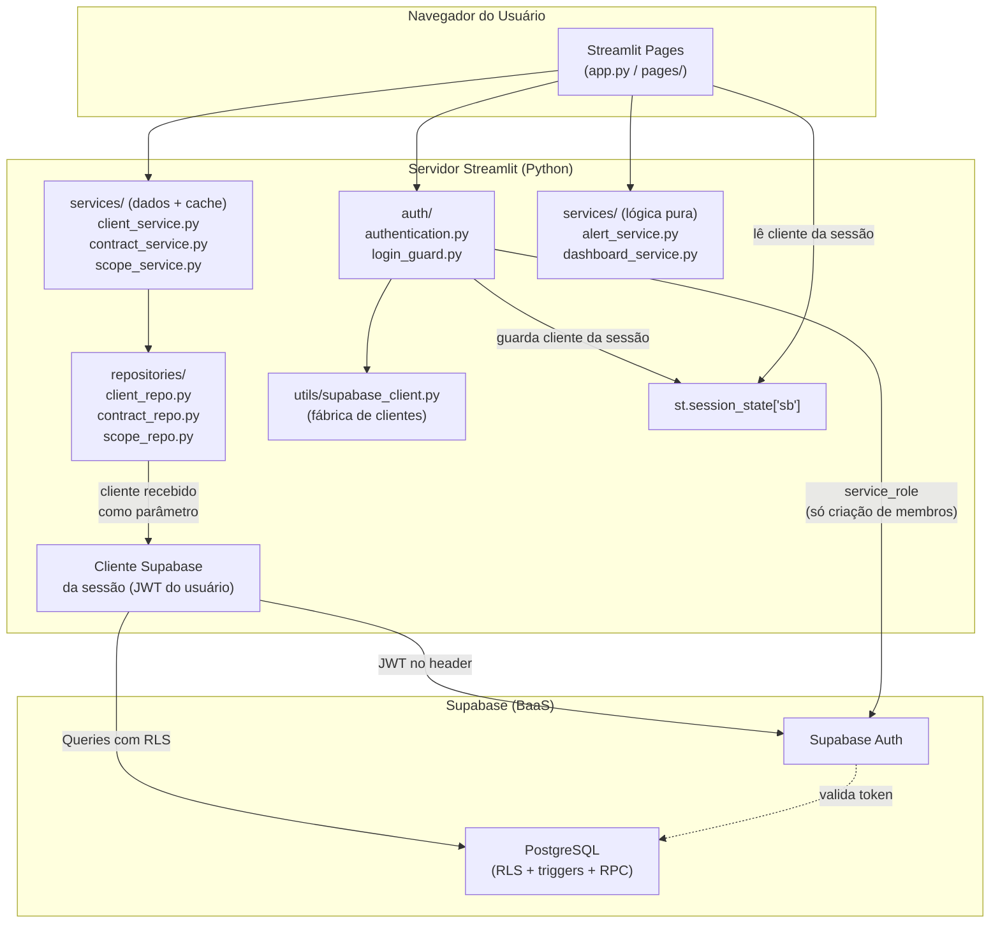
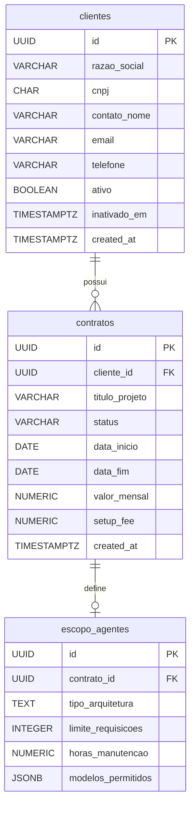
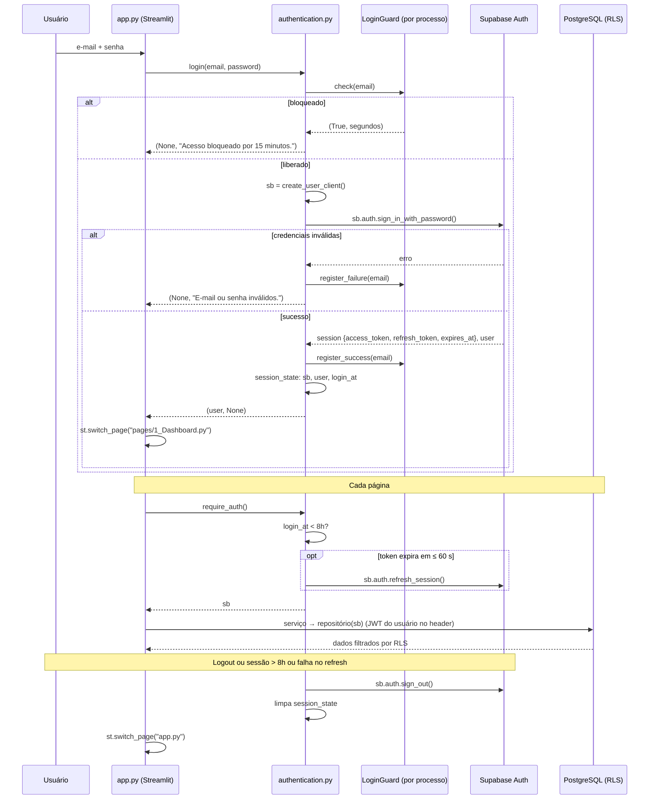

# Design Document

## Overview

O **CRM para Agentes de IA** é uma aplicação web interna construída com **Python + Streamlit** e **Supabase (PostgreSQL)**. O sistema permite que equipes internas gerenciem clientes, contratos de agentes de IA e escopos técnicos, além de acompanhar métricas de receita recorrente (MRR) e receber alertas visuais de vencimento de contratos.

### Objetivos de Design

- **Segurança em camadas**: autenticação via Supabase Auth (JWT) com um cliente Supabase **por sessão de usuário**, combinada com RLS no banco de dados e regras críticas reforçadas por constraints, triggers e funções SQL.
- **Separação de responsabilidades**: repositórios isolam o acesso ao Supabase e não conhecem o Streamlit; serviços orquestram validação, cache e invalidação; páginas lidam exclusivamente com apresentação.
- **Performance**: cache com `@st.cache_data` (TTL 300 s) na camada de serviços; invalidação cirúrgica após escritas.
- **Usabilidade**: dark mode corporativo, indicadores visuais de alerta com **quatro níveis** (atenção, urgente, crítico, vencido).
- **Auditabilidade**: registros nunca são excluídos — inativação de clientes e cancelamento de contratos são operações de atualização de estado.

### Abordagem Técnica

| Camada | Tecnologia |
|---|---|
| Interface de usuário | Streamlit 1.x (multi-page app) |
| Orquestração / cache | Python (módulos `services/`) com `@st.cache_data` |
| Lógica de domínio pura | Python (`services/alert_service.py`, `services/dashboard_service.py`, `utils/validators.py`) |
| Acesso a dados | supabase-py (padrão repositório, cliente injetado) |
| Banco de dados | PostgreSQL via Supabase |
| Autenticação | Supabase Auth + JWT + refresh token |
| Segurança de dados | Row Level Security (RLS) `TO authenticated` |

**Versão do Python:** 3.10 ou superior (alvo recomendado: 3.12). As versões exatas das dependências são fixadas em `requirements.txt` na tarefa 1, após verificar a compatibilidade com o interpretador utilizado. Se alguma dependência não tiver suporte ao Python instalado, utiliza-se um ambiente virtual com Python 3.12.

---

## Architecture

### Diagrama de Componentes



### Fluxo de Camadas

```
Página Streamlit (UI)
        │  chama (passando o cliente da sessão)
        ▼
Serviço de dados (validação + cache + invalidação)   ← único lugar com @st.cache_data
        │  chama
        ▼
Repositório (supabase-py puro, sem st.*)
        │  envia JWT do usuário da sessão
        ▼
Supabase (Auth + PostgreSQL + RLS + triggers/RPC)
```

### Princípios Arquiteturais

1. **Nenhuma chamada ao Supabase nas páginas**: páginas não importam `supabase` nem `repositories/`; acessam dados apenas via `services/` e autenticação apenas via `auth/`.
2. **Nenhuma referência a `st.*` nos repositórios**: repositórios são funções puras de acesso a dados que recebem o cliente Supabase como primeiro parâmetro.
3. **Um cliente Supabase por sessão**: `utils/supabase_client.py` é uma **fábrica** (não um singleton). No login, `auth/authentication.py` cria um cliente dedicado e o guarda em `st.session_state["sb"]`. Um cliente compartilhado entre sessões é proibido, pois faria um usuário operar com o JWT de outro.
4. **Chave `service_role` confinada**: usada somente em `auth/authentication.py`, por um cliente administrativo criado sob demanda e descartado ao fim da operação de criação de membro.
5. **Regras críticas no banco**: unicidade de CNPJ, checks de domínio, bloqueio de contrato para cliente inativo, imutabilidade de `contrato_id` do escopo e inativação em cascata são garantidos no PostgreSQL, além da validação na aplicação.
6. **Estado de sessão centralizado**: `st.session_state` guarda o cliente da sessão, o perfil do usuário e o instante do login; todas as páginas chamam `require_auth()` antes de renderizar.

---

## Components and Interfaces

### Estrutura de Arquivos (raiz do projeto `C:\Dev\CRM`)

```
.
├── app.py                          # Página de Login (ponto de entrada)
├── pages/
│   ├── 1_Dashboard.py              # Métricas e alertas consolidados
│   ├── 2_Clientes.py               # CRUD de clientes
│   ├── 3_Contratos.py              # CRUD de contratos + escopos
│   └── 4_Configuracoes.py          # Perfil e cadastro de membros
├── repositories/                   # supabase-py puro — sem st.*
│   ├── __init__.py
│   ├── client_repo.py              # tabela clientes + RPC inativar_cliente
│   ├── contract_repo.py            # tabela contratos
│   └── scope_repo.py               # tabela escopo_agentes
├── services/
│   ├── __init__.py
│   ├── result.py                   # ServiceResult (data, error, warning)
│   ├── cache_utils.py              # safe_clear(): invalidação com aviso em caso de falha
│   ├── client_service.py           # validação + cache + invalidação de clientes
│   ├── contract_service.py         # validação + cache + invalidação de contratos
│   ├── scope_service.py            # validação + cache + invalidação de escopos
│   ├── alert_service.py            # cálculo de níveis de alerta (puro)
│   └── dashboard_service.py        # agregação de métricas (puro)
├── auth/
│   ├── __init__.py
│   ├── authentication.py           # login, logout, sessão, perfil, criação de membros
│   └── login_guard.py              # controle de tentativas por e-mail (puro)
├── utils/
│   ├── __init__.py
│   ├── supabase_client.py          # fábrica: create_user_client(), create_admin_client()
│   ├── converters.py               # to_decimal() / to_date() tolerantes (form e PostgREST)
│   ├── validators.py               # validações de CNPJ, e-mail, datas, valores, escopo
│   ├── ui.py                       # helpers de página: setup, mensagens flash, load_or_stop
│   └── formatters.py               # formatação monetária, datas, CNPJ
├── sql/
│   ├── 01_schema.sql               # tabelas, constraints, índices
│   ├── 02_functions_triggers.sql   # RPC inativar_cliente + triggers de integridade
│   ├── 03_rls.sql                  # RLS e políticas TO authenticated
│   └── 04_bootstrap_admin.sql      # define o primeiro Admin (execução manual)
├── tests/
│   ├── conftest.py
│   ├── test_validators.py
│   ├── test_formatters.py
│   ├── test_login_guard.py
│   ├── test_authentication.py
│   ├── test_client_repo.py
│   ├── test_contract_repo.py
│   ├── test_scope_repo.py
│   ├── test_services_cache.py
│   ├── test_alert_service.py
│   ├── test_dashboard_service.py
│   ├── test_architecture.py        # verifica separação de camadas (Req 9.1, 7.5)
│   └── test_pages.py               # smoke tests das telas (streamlit.testing)
├── scripts/
│   └── verificar_supabase.py       # verificação de integração contra o Supabase real
├── .streamlit/
│   └── config.toml                 # tema dark corporativo
├── config.py                       # variáveis de ambiente e constantes
├── requirements.txt
├── .env.example
└── README.md
```

### Configuração (`config.py`)

Lê variáveis de ambiente com fallback para `.env` (via `python-dotenv`). Não referencia `st.*`.

| Constante | Origem | Uso |
|---|---|---|
| `SUPABASE_URL` | env | todos os clientes |
| `SUPABASE_ANON_KEY` | env | clientes de sessão |
| `SUPABASE_SERVICE_ROLE_KEY` | env (opcional) | apenas `create_team_member()`; se ausente, a funcionalidade exibe erro de configuração |
| `CACHE_TTL` | constante = 300 | `@st.cache_data` |
| `SESSION_MAX_HOURS` | constante = 8 | `is_session_valid()` |
| `TOKEN_REFRESH_MARGIN_SECONDS` | constante = 60 | renovação antecipada do token |
| `LOGIN_MAX_ATTEMPTS` | constante = 5 | `LoginGuard` |
| `LOGIN_LOCKOUT_MINUTES` | constante = 15 | `LoginGuard` |

### Fábrica de clientes (`utils/supabase_client.py`)

```python
from supabase import Client, create_client
from supabase.lib.client_options import ClientOptions

def create_user_client() -> Client:
    """Cria um cliente NOVO com a chave anon, dedicado a uma sessão de usuário.
    auto_refresh_token=False: a renovação é feita explicitamente em require_auth(),
    evitando threads de timer por sessão. persist_session=False: nada é gravado em disco."""
    return create_client(SUPABASE_URL, SUPABASE_ANON_KEY,
                         options=ClientOptions(auto_refresh_token=False, persist_session=False))

def create_admin_client() -> Client:
    """Cliente com service_role. USO EXCLUSIVO de auth/authentication.py (verificado em test_architecture)."""
```

### Interfaces dos Repositórios (sem `st.*`, cliente injetado)

Todas as funções recebem `client: Client` como primeiro parâmetro, nunca lançam exceções para o chamador e retornam `(resultado, mensagem_erro)`. Erros do PostgREST/PostgreSQL são traduzidos para mensagens em português (ex.: código `23505` em `cnpj` → "CNPJ já cadastrado na base de dados.").

#### `client_repo.py`

```python
def list_clients(client, search: str = "") -> tuple[list[dict] | None, str | None]: ...
# search vazio → todos; 14 dígitos → igualdade exata em cnpj; caso contrário → ILIKE '%search%' em razao_social

def get_client_by_id(client, client_id: str) -> tuple[dict | None, str | None]: ...

def cnpj_exists(client, cnpj: str) -> tuple[bool | None, str | None]: ...

def create_client(client, data: dict) -> tuple[dict | None, str | None]: ...
# pré-verifica CNPJ; ainda assim trata violação 23505 (condição de corrida)

def update_client(client, client_id: str, data: dict) -> tuple[bool, str | None]: ...
# envia apenas razao_social, contato_nome, email, telefone — demais chaves são descartadas

def deactivate_client(client, client_id: str) -> tuple[int | None, str | None]: ...
# client.rpc("inativar_cliente", {"p_cliente_id": client_id}) — atômico; retorna a quantidade de contratos cancelados
```

#### `contract_repo.py`

```python
def list_contracts(client, client_id: str | None = None) -> tuple[list[dict] | None, str | None]: ...
# select "*, clientes(razao_social)" para exibir o nome do cliente na listagem

def get_contract_by_id(client, contract_id: str) -> tuple[dict | None, str | None]: ...

def create_contract(client, data: dict) -> tuple[dict | None, str | None]: ...
# trigger no banco rejeita cliente inativo; mensagem traduzida para "O cliente selecionado está inativo."

def update_contract(client, contract_id: str, data: dict) -> tuple[bool, str | None]: ...
# cliente_id não é editável

def cancel_contract(client, contract_id: str) -> tuple[bool, str | None]: ...
# update status = 'Cancelado' (nunca DELETE)
```

#### `scope_repo.py`

```python
def get_scope_by_contract(client, contract_id: str) -> tuple[dict | None, str | None]: ...
def get_scope_by_id(client, scope_id: str) -> tuple[dict | None, str | None]: ...
def create_scope(client, data: dict) -> tuple[dict | None, str | None]: ...
def update_scope(client, scope_id: str, data: dict) -> tuple[bool, str | None]: ...
# envia apenas tipo_arquitetura, limite_requisicoes, horas_manutencao, modelos_permitidos
```

### Serviços de Dados (validação + cache + invalidação)

Únicos módulos com `@st.cache_data`. As leituras cacheadas recebem o cliente como `_sb` — o prefixo `_` faz o Streamlit **excluir** o parâmetro do hash da chave de cache.

> **Escopo do cache:** como o cliente não entra na chave, o cache é compartilhado entre sessões. Isso é correto enquanto a política RLS conceder os mesmos dados a todos os usuários autenticados (Req 8.4). Se o RLS passar a ser por usuário, as leituras devem receber `user_id` como parâmetro hasheável.

```python
# services/result.py
class ServiceResult(NamedTuple):
    data: Any = None           # registro/booleano em caso de sucesso
    error: str | None = None   # mensagem para st.error()
    warning: str | None = None # mensagem para st.warning() (ex.: falha de invalidação de cache)

# services/cache_utils.py
CACHE_WARNING = "Dados podem estar desatualizados. Recarregue a página manualmente."
def safe_clear(*cached_functions) -> str | None:
    """Chama .clear() em cada função; retorna CACHE_WARNING se alguma falhar (a escrita é mantida)."""
```

```python
# services/client_service.py
@st.cache_data(ttl=CACHE_TTL)
def list_clients(_sb, search: str = "") -> list[dict]: ...      # lança exceção se o repo falhar (não cacheia erro)

def create_client(sb, data: dict) -> ServiceResult: ...          # validators → repo → safe_clear(list_clients)
def update_client(sb, client_id: str, data: dict) -> ServiceResult: ...
def deactivate_client(sb, client_id: str) -> ServiceResult: ...  # safe_clear(list_clients, contract_service.list_contracts)

# services/contract_service.py
@st.cache_data(ttl=CACHE_TTL)
def list_contracts(_sb, client_id: str | None = None) -> list[dict]: ...
def create_contract(sb, data: dict) -> ServiceResult: ...        # valida datas, valores, status, cliente ativo
def update_contract(sb, contract_id: str, data: dict) -> ServiceResult: ...
def cancel_contract(sb, contract_id: str) -> ServiceResult: ...

# services/scope_service.py
@st.cache_data(ttl=CACHE_TTL)
def get_scope_by_contract(_sb, contract_id: str) -> dict | None: ...
def create_scope(sb, data: dict) -> ServiceResult: ...
def update_scope(sb, scope_id: str, data: dict) -> ServiceResult: ...
# rejeita contrato_id diferente do original (Req 4.11) e scope_id inexistente (Req 4.12)
```

Leituras cacheadas **lançam exceção** em caso de falha do repositório, para que o erro não seja armazenado em cache; as páginas capturam a exceção e exibem a mensagem + botão "Recarregar".

### Módulo de Autenticação

#### `auth/login_guard.py` (puro, testável sem Streamlit)

```python
class LoginGuard:
    def __init__(self, max_attempts: int = 5, lockout: timedelta = timedelta(minutes=15),
                 clock: Callable[[], datetime] = lambda: datetime.now(timezone.utc)): ...
    @staticmethod
    def normalize(email: str) -> str: ...                   # strip().lower()
    def check(self, email: str) -> tuple[bool, int]: ...     # (bloqueado?, segundos restantes)
    def register_failure(self, email: str) -> None: ...      # 5ª falha consecutiva → bloqueia por 15 min
    def register_success(self, email: str) -> None: ...      # zera contagem
```

- Estado interno: `dict[email, (falhas_consecutivas, bloqueado_ate)]` protegido por `threading.Lock`.
- Ao expirar o bloqueio, a contagem é zerada.
- Instância única **por processo**, obtida em `authentication.py` via `@st.cache_resource` — compartilhada por todas as sessões, de modo que F5 ou nova aba não zeram a contagem.
- **Limitação aceita:** o contador é perdido ao reiniciar o servidor e não é compartilhado entre múltiplas instâncias. Para implantação com várias réplicas, migrar para uma tabela `login_tentativas` acessada somente com `service_role` (nunca pela chave anon, pois o usuário ainda não está autenticado).

#### `auth/authentication.py`

```python
def login(email: str, password: str) -> tuple[dict | None, str | None]:
    """Valida formato (e-mail, senha ≥ 8) → LoginGuard.check → create_user_client()
    → sign_in_with_password(). Sucesso: guarda em st.session_state 'sb' (cliente),
    'user' {id, email, nome, role} e 'login_at' (UTC); register_success.
    Falha: register_failure; mensagem genérica 'E-mail ou senha inválidos.'"""

def logout() -> None:
    """sb.auth.sign_out() (erros ignorados) e limpa as chaves de sessão."""

def get_current_user() -> dict | None: ...
def get_session_client() -> Client | None: ...   # st.session_state.get("sb")

def is_session_valid() -> bool:
    """False se não houver cliente/sessão ou se now - login_at ≥ 8h.
    Se o access token expira em ≤ 60 s, chama sb.auth.refresh_session();
    falha na renovação → False."""

def require_auth() -> Client:
    """Se inválida: logout() + st.switch_page('app.py'). Caso contrário retorna o cliente da sessão."""

ROLE_ADMIN = "admin"
ROLE_MEMBER = "membro"
VALID_ROLES = (ROLE_MEMBER, ROLE_ADMIN)

def extract_role(user) -> str:
    """Lê app_metadata.role do usuário do Supabase Auth; ausente ou inválido → 'membro'.
    Nunca lê user_metadata (editável pelo próprio usuário)."""

def is_admin(user: dict | None = None) -> bool:
    """Usado pela UI para exibir/ocultar a seção de cadastro (usa o perfil da sessão)."""

def render_user_sidebar() -> None:
    """Sidebar comum: nome, e-mail, perfil e botão "Sair"."""

def update_profile(nome: str, email: str) -> tuple[bool, str | None, str | None]:
    """sb.auth.update_user({'email': ..., 'data': {'nome': ...}}).
    Retorna (ok, erro, aviso) — aviso sobre confirmação de e-mail quando o e-mail muda."""

def create_team_member(nome: str, email: str, role: str = ROLE_MEMBER) -> tuple[str | None, str | None]:
    """1) Revalida o perfil do solicitante no servidor: sb.auth.get_user() da sessão →
          extract_role() == 'admin'; caso contrário retorna (None, 'Permissão negada: apenas
          administradores podem cadastrar membros.').
       2) Valida nome, e-mail e role ∈ VALID_ROLES.
       3) create_admin_client() → auth.admin.create_user({email, password: secrets.token_urlsafe(12),
          email_confirm: True, user_metadata: {nome}, app_metadata: {role}}).
       Retorna (senha_temporaria, erro). O cliente admin é descartado; a senha não é persistida."""
```

O nome do usuário é armazenado em `user_metadata.nome` do Supabase Auth.

#### Perfis de acesso (Admin / Membro)

- O perfil fica em `app_metadata.role` (valores `"admin"` ou `"membro"`). `app_metadata` só pode ser alterado com `service_role`, então o usuário não consegue se promover — diferente de `user_metadata`, que o próprio usuário edita via `update_user`.
- O perfil é lido no login e guardado em `st.session_state["user"]["role"]` para a UI. A **autorização** de `create_team_member` não confia nesse valor: consulta `sb.auth.get_user()` no momento da operação, refletindo mudanças de perfil feitas depois do login.
- O perfil não altera as políticas de RLS: Admin e Membro têm o mesmo acesso a clientes, contratos e escopos. A única diferença é o cadastro de membros.
- **Bootstrap do primeiro Admin** (`sql/04_bootstrap_admin.sql`): após criar o primeiro usuário pelo painel do Supabase (Authentication → Users → Add user), executar no SQL Editor:

```sql
UPDATE auth.users
   SET raw_app_meta_data = coalesce(raw_app_meta_data, '{}'::jsonb) || '{"role": "admin"}'::jsonb
 WHERE email = 'admin@suaempresa.com.br';   -- substituir pelo e-mail do primeiro Admin
```

O usuário precisa fazer login novamente para que o novo perfil apareça no token.

### Serviço de Alertas (`services/alert_service.py`)

```python
class AlertLevel(IntEnum):
    NONE = 0       # > 30 dias, ou status não elegível
    ATTENTION = 1  # 16–30 dias
    URGENT = 2     # 8–15 dias
    CRITICAL = 3   # 1–7 dias
    EXPIRED = 4    # data_fim ≤ hoje (dias ≤ 0)

ALERT_ELIGIBLE_STATUSES = frozenset({"Ativo", "Renovação Pendente"})

def days_remaining(contract: dict, reference_date: date | None = None) -> int: ...
def get_alert_level(contract: dict, reference_date: date | None = None) -> AlertLevel: ...
def get_expiring_contracts(contracts: list[dict], reference_date: date | None = None) -> list[dict]:
    """Contratos elegíveis com nível ≠ NONE, ordenados por dias restantes."""
def alert_badge(level: AlertLevel, days: int) -> str:
    """Texto com ícone distinto por nível, ex.: '🟡 30 dias', '🟠 12 dias', '🔴 5 dias', '⛔ Vencido'."""
```

`data_fim` pode chegar como `date` ou string ISO (`"2026-10-18"`) — ambos são aceitos. `reference_date=None` usa `date.today()` do servidor (Req 5.4).

### Serviço de Dashboard (`services/dashboard_service.py`)

```python
def calculate_mrr(contracts: list[dict]) -> Decimal: ...           # soma valor_mensal dos 'Ativo'; Decimal('0') se nenhum
def count_by_status(contracts: list[dict]) -> dict[str, int]: ...   # sempre as 4 chaves, mesmo com 0
def expiration_distribution(contracts: list[dict], reference_date: date | None = None) -> dict[str, int]: ...
# faixas: "Vencidos", "1-7 dias", "8-15 dias", "16-30 dias", "> 30 dias"
# considera contratos com status diferente de 'Cancelado'
```

`valor_mensal` pode chegar do PostgREST como `str`, `int` ou `float`; é convertido via `Decimal(str(v))` para não perder precisão.

### Componentes de UI por Tela

Todas as páginas obtêm o cliente com `sb = require_auth()` e repassam `sb` aos serviços. Exibem `result.error` com `st.error()` e `result.warning` com `st.warning()`.

#### `app.py` — Login
- Formulário central (`st.form`) com **E-mail** e **Senha**; botão "Entrar" chama `authentication.login()`.
- Erro genérico via `st.error()`, sem indicar o campo incorreto.
- Bloqueio: `st.error("Acesso bloqueado por 15 minutos.")` com minutos restantes.
- Sucesso → `st.switch_page("pages/1_Dashboard.py")`. Se já houver sessão válida, redireciona direto.

#### `pages/1_Dashboard.py` — Dashboard
- `st.metric()`: MRR total (`format_currency`) e total de contratos ativos.
- Contagens por status em 4 colunas.
- `st.bar_chart` com `expiration_distribution()`.
- Lista de contratos de `get_expiring_contracts()` com `alert_badge()`.
- Falha de leitura → `st.error(...)` + `st.button("Recarregar")` → `st.rerun()`.
- Sidebar com `render_user_sidebar()`.

#### `pages/2_Clientes.py` — Clientes
- Busca (`st.text_input`): parcial em razao_social, exata em CNPJ (aceita CNPJ formatado; normaliza para dígitos).
- `st.dataframe()` com coluna "Status" = "Ativo"/"Inativo" e CNPJ formatado.
- "Novo Cliente" (`st.form` com `clear_on_submit=False` para preservar dados em erro — Req 2.3).
- "Editar Cliente": CNPJ exibido como somente leitura.
- "Inativar" com confirmação via `st.dialog`, avisando quantos contratos serão cancelados.

#### `pages/3_Contratos.py` — Contratos
- Filtros por cliente e por status.
- `st.dataframe()` com coluna de alerta (`alert_badge`).
- "Novo Contrato": seletor apenas de clientes ativos + campos financeiros; `st.form(clear_on_submit=False)`.
- Edição de status do contrato selecionado.
- Seção "Escopo do Agente" do contrato selecionado: cria ou edita; `modelos_permitidos` informado um por linha (`st.text_area`).
- "Cancelar Contrato" com confirmação via `st.dialog`.

#### `pages/4_Configuracoes.py` — Configurações
- Perfil: nome e e-mail pré-preenchidos → `authentication.update_profile()`; mostra aviso de confirmação de e-mail quando aplicável.
- "Novo Membro da Equipe" — **visível apenas para Admin** (`is_admin()`): nome + e-mail + perfil (Membro/Admin) → `authentication.create_team_member()`; senha temporária exibida **uma vez** com `st.code()` e instrução para repassá-la.
- Para Membros, a seção é omitida e a página informa que o cadastro é restrito a administradores.

Em todas as páginas, `render_user_sidebar()` exibe na sidebar o nome, o e-mail e o perfil do usuário logado e o botão "Sair".

#### `.streamlit/config.toml` — Tema

```toml
[theme]
base = "dark"
primaryColor = "#4F8BF9"
backgroundColor = "#0E1117"
secondaryBackgroundColor = "#1A1F2B"
textColor = "#E6E6E6"
```

---

## Data Models

### Tabela `clientes`

| Coluna | Tipo | Restrições | Descrição |
|---|---|---|---|
| `id` | UUID | PK, DEFAULT gen_random_uuid() | Identificador único |
| `razao_social` | VARCHAR(255) | NOT NULL | Razão social da empresa |
| `cnpj` | CHAR(14) | NOT NULL, UNIQUE, CHECK (cnpj ~ '^[0-9]{14}$') | 14 dígitos numéricos sem formatação |
| `contato_nome` | VARCHAR(150) | NOT NULL | Nome do contato principal |
| `email` | VARCHAR(255) | NOT NULL, CHECK (email LIKE '%_@_%._%') | E-mail do contato |
| `telefone` | VARCHAR(20) | NULL | Telefone de contato |
| `ativo` | BOOLEAN | NOT NULL, DEFAULT true | Status ativo/inativo |
| `inativado_em` | TIMESTAMPTZ | NULL | Timestamp de inativação |
| `created_at` | TIMESTAMPTZ | NOT NULL, DEFAULT now() | Timestamp de criação |

**Índices:**
- Unicidade de `cnpj` (o índice da constraint UNIQUE atende à busca exata)
- `idx_clientes_razao_social` — índice trigram (`pg_trgm`, `gin_trgm_ops`) em `razao_social` para `ILIKE '%termo%'`

### Tabela `contratos`

| Coluna | Tipo | Restrições | Descrição |
|---|---|---|---|
| `id` | UUID | PK, DEFAULT gen_random_uuid() | Identificador único |
| `cliente_id` | UUID | NOT NULL, FK → clientes(id) | Referência ao cliente |
| `titulo_projeto` | VARCHAR(255) | NOT NULL | Nome do projeto/contrato |
| `status` | VARCHAR(30) | NOT NULL, CHECK (status IN (...)) | Status do contrato |
| `data_inicio` | DATE | NOT NULL | Data de início do contrato |
| `data_fim` | DATE | NOT NULL, CHECK (data_fim > data_inicio) | Data de término |
| `valor_mensal` | NUMERIC(15,2) | NOT NULL, CHECK (valor_mensal BETWEEN 0.01 AND 999999999.99) | MRR em reais |
| `setup_fee` | NUMERIC(15,2) | NOT NULL, DEFAULT 0, CHECK (setup_fee BETWEEN 0 AND 999999999.99) | Taxa de implantação |
| `created_at` | TIMESTAMPTZ | NOT NULL, DEFAULT now() | Timestamp de criação |

```sql
CHECK (status IN ('Ativo', 'Em Implantação', 'Renovação Pendente', 'Cancelado'))
```

**Índices:** `idx_contratos_cliente_id`, `idx_contratos_status`, `idx_contratos_data_fim`.

### Tabela `escopo_agentes`

| Coluna | Tipo | Restrições | Descrição |
|---|---|---|---|
| `id` | UUID | PK, DEFAULT gen_random_uuid() | Identificador único |
| `contrato_id` | UUID | NOT NULL, FK → contratos(id), UNIQUE | Referência ao contrato (1:1) |
| `tipo_arquitetura` | TEXT | NOT NULL | Descrição do tipo de arquitetura |
| `limite_requisicoes` | INTEGER | NOT NULL, CHECK (limite_requisicoes BETWEEN 1 AND 10000000) | Limite de requisições |
| `horas_manutencao` | NUMERIC(7,1) | NOT NULL, CHECK (horas_manutencao BETWEEN 0.5 AND 8760) | Horas de manutenção contratadas |
| `modelos_permitidos` | JSONB | NOT NULL | Array de strings com modelos de IA |

```sql
CHECK (
    jsonb_typeof(modelos_permitidos) = 'array'
    AND jsonb_array_length(modelos_permitidos) BETWEEN 1 AND 50
)
```

O tipo e o tamanho de cada item (string, ≤ 100 caracteres) são validados na aplicação (`validate_modelos_permitidos`).

### Funções e Triggers de Integridade (`sql/02_functions_triggers.sql`)

```sql
-- Inativação atômica com cancelamento em cascata (Req 2.5, 2.7, 2.8)
CREATE OR REPLACE FUNCTION public.inativar_cliente(p_cliente_id uuid)
RETURNS integer                       -- quantidade de contratos cancelados
LANGUAGE plpgsql
SECURITY INVOKER                      -- respeita o RLS do usuário chamador
SET search_path = public
AS $$
DECLARE
    v_cancelados integer;
BEGIN
    UPDATE clientes
       SET ativo = false, inativado_em = now()
     WHERE id = p_cliente_id AND ativo;
    IF NOT FOUND THEN
        RAISE EXCEPTION 'Cliente não encontrado ou já inativo.' USING ERRCODE = 'P0002';
    END IF;

    UPDATE contratos
       SET status = 'Cancelado'
     WHERE cliente_id = p_cliente_id
       AND status IN ('Ativo', 'Em Implantação');
    GET DIAGNOSTICS v_cancelados = ROW_COUNT;
    RETURN v_cancelados;
END $$;

REVOKE ALL ON FUNCTION public.inativar_cliente(uuid) FROM PUBLIC, anon;
GRANT EXECUTE ON FUNCTION public.inativar_cliente(uuid) TO authenticated;

-- Contrato só pode ser criado para cliente ativo (Req 2.6, 3.2)
CREATE OR REPLACE FUNCTION public.verificar_cliente_ativo()
RETURNS trigger LANGUAGE plpgsql SET search_path = public AS $$
BEGIN
    IF NOT EXISTS (SELECT 1 FROM clientes WHERE id = NEW.cliente_id AND ativo) THEN
        RAISE EXCEPTION 'O cliente selecionado está inativo.' USING ERRCODE = 'P0001';
    END IF;
    RETURN NEW;
END $$;

CREATE TRIGGER trg_contratos_cliente_ativo
    BEFORE INSERT ON contratos
    FOR EACH ROW EXECUTE FUNCTION public.verificar_cliente_ativo();

-- contrato_id do escopo é imutável (Req 4.11)
CREATE OR REPLACE FUNCTION public.impedir_troca_contrato_escopo()
RETURNS trigger LANGUAGE plpgsql SET search_path = public AS $$
BEGIN
    IF NEW.contrato_id IS DISTINCT FROM OLD.contrato_id THEN
        RAISE EXCEPTION 'O campo contrato_id não pode ser alterado.' USING ERRCODE = 'P0001';
    END IF;
    RETURN NEW;
END $$;

CREATE TRIGGER trg_escopo_contrato_imutavel
    BEFORE UPDATE ON escopo_agentes
    FOR EACH ROW EXECUTE FUNCTION public.impedir_troca_contrato_escopo();
```

### Diagrama Entidade-Relacionamento



### Fluxo de Autenticação



---

## Correctness Properties

*Uma propriedade é uma característica ou comportamento que deve ser verdadeiro para todas as execuções válidas de um sistema — uma declaração formal sobre o que o sistema deve fazer, servindo de ponte entre especificações legíveis por humanos e garantias de corretude verificáveis por máquina.*

### Property 1: Validação de datas de contrato
*Para qualquer* par (data_inicio, data_fim), se data_fim ≤ data_inicio o sistema SHALL rejeitar; se data_fim > data_inicio SHALL aceitar.
**Validates: Requirements 3.4**

### Property 2: Nível de alerta é função determinística e correta da data
*Para qualquer* contrato com status "Ativo" ou "Renovação Pendente" e *para qualquer* data de referência, `get_alert_level` SHALL retornar sempre o mesmo nível para a mesma combinação (data_fim, data_referência), e esse nível SHALL corresponder à faixa de dias restantes: ≤ 0 → EXPIRED; 1–7 → CRITICAL; 8–15 → URGENT; 16–30 → ATTENTION; > 30 → NONE.
**Validates: Requirements 5.1, 5.2, 5.3, 5.4, 5.6**

### Property 3: Contratos não elegíveis não geram alertas
*Para qualquer* contrato com status "Cancelado" ou "Em Implantação", independentemente de data_fim, `get_alert_level` SHALL retornar `AlertLevel.NONE`.
**Validates: Requirements 5.5**

### Property 4: MRR é soma apenas de contratos ativos
*Para qualquer* lista de contratos, `calculate_mrr` SHALL ser igual à soma dos valor_mensal dos contratos "Ativo", e zero quando não houver ativos.
**Validates: Requirements 6.1**

### Property 5: Inativação preserva registro
*Para qualquer* cliente existente e ativo, após a inativação o registro SHALL continuar presente com `ativo = false` e `inativado_em` não nulo; o repositório SHALL usar a RPC `inativar_cliente` e nunca DELETE.
**Validates: Requirements 2.5**

### Property 6: CNPJ único por cliente
*Para qualquer* cadastro com CNPJ já existente, o `Cliente_Manager` SHALL rejeitar sem criar novo registro (pré-verificação na aplicação + constraint UNIQUE no banco).
**Validates: Requirements 2.3**

### Property 7: Escopo preserva contrato_id na edição
*Para qualquer* edição de escopo com scope_id válido, o payload enviado ao banco SHALL NOT conter `contrato_id` nem `id`, e uma tentativa de alterar `contrato_id` SHALL ser rejeitada (serviço + trigger).
**Validates: Requirements 4.10, 4.11**

### Property 8: Validação de limites numéricos do escopo
*Para qualquer* `limite_requisicoes` fora de [1, 10.000.000] ou `horas_manutencao` fora de [0,5, 8.760], o sistema SHALL rejeitar; dentro dos intervalos SHALL aceitar.
**Validates: Requirements 4.4, 4.5, 4.6, 4.7**

### Property 9: Cancelamento de contrato não exclui registro
*Para qualquer* contrato existente, após o cancelamento o registro SHALL continuar presente com `status = 'Cancelado'`; o repositório SHALL usar UPDATE e nunca DELETE.
**Validates: Requirements 3.10**

### Property 10: Valor monetário com duas casas decimais
*Para qualquer* valor_mensal ou setup_fee válido, a validação e a formatação SHALL preservar exatamente duas casas decimais, sem perda de precisão (uso de `Decimal`, nunca `float`, em cálculos).
**Validates: Requirements 3.6, 3.8**

### Property 11: Bloqueio de login após 5 falhas consecutivas
*Para qualquer* sequência de tentativas para um mesmo e-mail (em qualquer combinação de maiúsculas/espaços), o `LoginGuard` SHALL bloquear exatamente após a 5ª falha consecutiva, manter o bloqueio por 15 minutos, e uma tentativa bem-sucedida antes da 5ª falha SHALL zerar a contagem. Tentativas de outros e-mails SHALL NOT afetar a contagem.
**Validates: Requirements 1.6**

### Property 12: Invalidação de cache após escrita bem-sucedida
*Para qualquer* operação de escrita bem-sucedida em um serviço de dados, `.clear()` SHALL ser chamado nas leituras cacheadas de todas as entidades afetadas; para escrita que falha, o cache SHALL NOT ser invalidado; falha no `.clear()` SHALL produzir `warning` sem desfazer a escrita.
**Validates: Requirements 8.2, 8.3**

### Property 13: Apenas Admin cadastra membros
*Para qualquer* usuário solicitante cujo `app_metadata.role` (obtido do Supabase Auth no momento da operação) seja diferente de `"admin"` — incluindo ausente, inválido, ou com `user_metadata.role = "admin"` —, `create_team_member` SHALL rejeitar a operação sem criar o cliente administrativo. `extract_role` SHALL retornar `"membro"` para qualquer valor que não seja exatamente `"admin"`.
**Validates: Requirements 11.1, 11.2, 11.4**

---

## Error Handling

### Estratégia Geral

- Repositórios retornam `(resultado, erro)`; `erro` é uma string em português pronta para a UI.
- Serviços de escrita retornam `ServiceResult(data, error, warning)`.
- Leituras cacheadas lançam exceção em falha (para não cachear o erro); páginas capturam e exibem mensagem + "Recarregar".
- Páginas nunca exibem exceções brutas ao usuário.

### Mapeamento de Erros

| Situação | Origem | Mensagem na UI |
|---|---|---|
| Credenciais inválidas | Auth | `st.error("E-mail ou senha inválidos.")` |
| Bloqueio de login | LoginGuard | `st.error("Acesso bloqueado por 15 minutos.")` |
| CNPJ duplicado | validação / `23505` | "CNPJ já cadastrado na base de dados." |
| Cliente inativo ao criar contrato | validação / trigger `P0001` | "O cliente selecionado está inativo." |
| Cliente inexistente/já inativo | RPC `P0002` | "Cliente não encontrado ou já inativo." |
| data_fim ≤ data_inicio | validação / CHECK | "A data de término deve ser posterior à data de início." |
| valor_mensal inválido | validação | "Valor mensal inválido. Informe um valor entre R$ 0,01 e R$ 999.999.999,99." |
| setup_fee inválido | validação | "Setup fee inválido. Informe um valor entre R$ 0,00 e R$ 999.999.999,99." |
| Contrato não encontrado | repositório | "Contrato não encontrado." |
| Escopo não encontrado | repositório | "Escopo não encontrado." |
| Troca de contrato_id do escopo | serviço / trigger | "O campo contrato_id não pode ser alterado." |
| Falha de conexão | repositório | "Falha ao carregar dados. Verifique a conexão." + botão Recarregar |
| JWT expirado/inválido ou refresh falhou | auth | redirecionamento automático para Login |
| Solicitante não é Admin | auth | "Permissão negada: apenas administradores podem cadastrar membros." |
| `service_role` não configurada | auth | "Cadastro de membros indisponível: chave administrativa não configurada." |
| Falha na invalidação do cache | `safe_clear` | `st.warning("Dados podem estar desatualizados. Recarregue a página manualmente.")` |

### Falha no Carregamento do Dashboard

```python
sb = require_auth()
try:
    contracts = contract_service.list_contracts(sb)
except Exception:
    st.error("Falha no carregamento dos dados. Tente novamente.")
    if st.button("Recarregar"):
        st.rerun()
    st.stop()
```

---

## Testing Strategy

### Abordagem

1. **Testes unitários com exemplos** — cenários específicos, bordas e erros.
2. **Testes baseados em propriedades (Hypothesis)** — propriedades universais nos módulos puros (validators, alert_service, dashboard_service, login_guard).
3. **Testes de arquitetura** — verificam estaticamente a separação de camadas.

### Ferramentas

- **pytest**, **hypothesis** (`settings(max_examples=100)`), **pytest-mock**.
- Repositórios testados com um cliente Supabase **mock** injetado (sem rede).
- Serviços de dados testados com repositórios mockados, verificando chamadas a `.clear()`.
- `authentication.py` testado com `st.session_state` e `create_user_client` mockados.
- Cada property test é anotado com `# Feature: crm-agentes-ia, Property N: <texto>`.

### Testes Unitários (destaques)

- **validators**: CNPJ 14 dígitos válido, 13/15 ou com letras inválido; e-mail sem "@" inválido; data_fim = data_inicio inválido; valor_mensal 0 inválido, 0.01 e 999999999.99 válidos, 3 casas decimais inválido; limite_requisicoes 0/1/10000000/10000001; horas_manutencao 0.4/0.5/8760/8760.1; modelos vazio, com 51 itens, com item de 101 chars ou não-string → inválido.
- **alert_service**: hoje → EXPIRED; +1 e +7 → CRITICAL; +8 e +15 → URGENT; +16 e +30 → ATTENTION; +31 → NONE; "Cancelado"/"Em Implantação" amanhã → NONE; data_fim em string ISO.
- **dashboard_service**: lista vazia → MRR 0; só cancelados → 0; mix → soma dos ativos; valores em string; `count_by_status` com as 4 chaves; distribuição por faixa nas bordas.
- **login_guard**: 4 falhas não bloqueiam, 5ª bloqueia; bloqueio expira após 15 min (relógio injetado); sucesso zera; normalização de e-mail.
- **authentication**: login válido grava `sb`, `user`, `login_at`; inválido retorna erro genérico; sessão > 8h inválida; refresh chamado quando o token está perto de expirar; falha no refresh invalida; `create_team_member` sem `service_role` retorna erro; `create_team_member` por Membro é negado sem criar cliente admin; `user_metadata.role = "admin"` não concede permissão; role inválido no cadastro é rejeitado.
- **repositórios**: CNPJ duplicado; `update_client` descarta `cnpj`/`id`/`created_at`; `deactivate_client` chama a RPC; `cancel_contract` usa update; tradução de erro do trigger; `update_scope` não envia `contrato_id`.
- **serviços de dados**: escrita bem-sucedida chama `.clear()`; escrita com erro não chama; exceção no `.clear()` gera `warning`; inativação limpa clientes **e** contratos.
- **arquitetura**: nenhum arquivo em `repositories/` importa `streamlit`; nenhum arquivo em `app.py`/`pages/` importa `supabase`, `repositories` ou `utils.supabase_client`; `create_admin_client` só é referenciado em `auth/authentication.py`.

### Testes de Integração (manuais, após criação do projeto Supabase)

- RLS: consulta com chave anon sem login retorna zero registros.
- Login/logout: sessão criada e limpa corretamente.
- Inativação em cascata: contratos "Ativo"/"Em Implantação" passam a "Cancelado" e "Renovação Pendente" permanece.
- Trigger: inserir contrato para cliente inativo falha.
- Duas sessões simultâneas com usuários diferentes não compartilham identidade.
- Membro não vê a seção de cadastro; Admin cadastra um Membro e um Admin; o novo usuário loga com a senha temporária.

### Configuração de RLS (`sql/03_rls.sql`)

```sql
ALTER TABLE clientes       ENABLE ROW LEVEL SECURITY;
ALTER TABLE contratos      ENABLE ROW LEVEL SECURITY;
ALTER TABLE escopo_agentes ENABLE ROW LEVEL SECURITY;

-- Acesso completo apenas para usuários autenticados; anon não possui política (zero acesso)
CREATE POLICY "authenticated_all" ON clientes
    FOR ALL TO authenticated USING (true) WITH CHECK (true);

CREATE POLICY "authenticated_all" ON contratos
    FOR ALL TO authenticated USING (true) WITH CHECK (true);

CREATE POLICY "authenticated_all" ON escopo_agentes
    FOR ALL TO authenticated USING (true) WITH CHECK (true);
```

### Estratégia de Cache e Invalidação

```python
# services/client_service.py
@st.cache_data(ttl=CACHE_TTL)
def list_clients(_sb, search: str = "") -> list[dict]:
    data, err = client_repo.list_clients(_sb, search)
    if err:
        raise RuntimeError(err)          # não cacheia falhas
    return data

def create_client(sb, data: dict) -> ServiceResult:
    ok, err = validate_client_payload(data)
    if not ok:
        return ServiceResult(error=err)
    created, err = client_repo.create_client(sb, data)
    if err:
        return ServiceResult(error=err)  # sem invalidação
    return ServiceResult(data=created, warning=safe_clear(list_clients))

def deactivate_client(sb, client_id: str) -> ServiceResult:
    ok, err = client_repo.deactivate_client(sb, client_id)
    if err:
        return ServiceResult(error=err)
    return ServiceResult(data=ok, warning=safe_clear(list_clients, contract_service.list_contracts))
```

A mesma lógica se aplica a `contract_service.py` (invalida `list_contracts`) e `scope_service.py` (invalida `get_scope_by_contract`).
