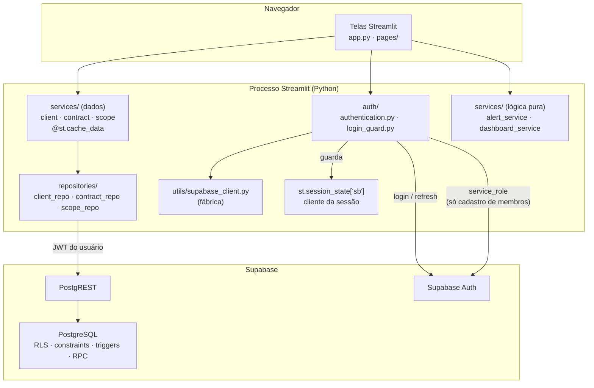
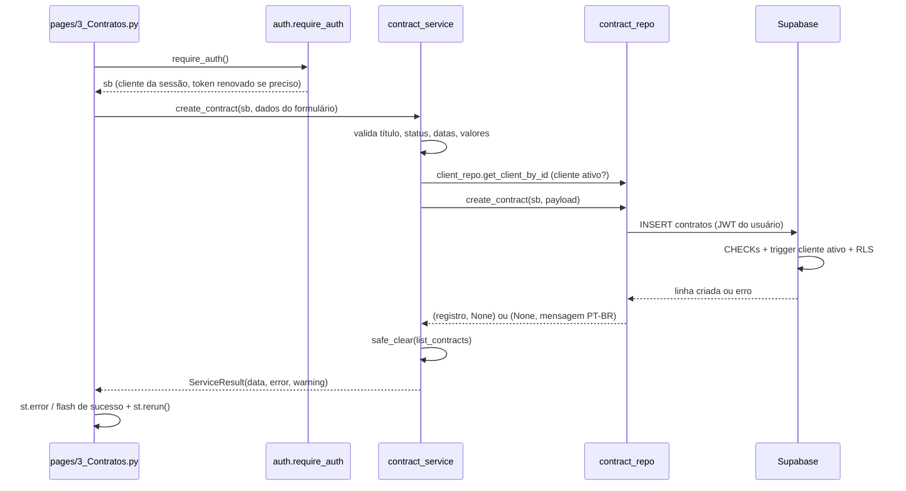

# Arquitetura

> Público: desenvolvedores. Para instalar e operar, veja [operacao.md](operacao.md).

O CRM para Agentes de IA é uma aplicação **Streamlit multipágina** que usa o **Supabase** (PostgreSQL + Auth + PostgREST) como backend. Não há servidor de API próprio: o processo Streamlit conversa diretamente com o Supabase usando o `supabase-py`, sempre com o JWT do usuário logado.

## Visão geral



## Camadas e regras de dependência

| Camada | Pasta | Responsabilidade | Pode usar | Não pode usar |
|---|---|---|---|---|
| Interface | `app.py`, `pages/` | Renderizar telas, ler formulários, exibir mensagens | `services/`, `auth/`, `utils/` | `supabase`, `postgrest`, `repositories/`, `utils.supabase_client`, chamadas `.table()`, `.rpc()` e `.auth.` |
| Autenticação | `auth/` | Login, sessão, perfis, cadastro de membros | `utils/`, `supabase_auth`, `streamlit` | — |
| Serviços de dados | `services/*_service.py` | Validação, cache, invalidação, regras de orquestração | `repositories/`, `utils/`, `streamlit` (cache) | — |
| Lógica pura | `services/alert_service.py`, `services/dashboard_service.py` | Cálculos de alerta e métricas | `utils/` | `streamlit`, Supabase |
| Repositórios | `repositories/` | Consultas ao Supabase, tradução de erros | `postgrest`, `utils/` | `streamlit` (nenhum `st.*`) |
| Utilitários | `utils/` | Fábrica de clientes, validadores, conversores, formatadores, helpers de UI | — | — |

Essas regras não dependem só de disciplina: o arquivo [`tests/test_architecture.py`](../tests/test_architecture.py) as verifica a cada execução dos testes (veja [desenvolvimento.md](desenvolvimento.md#testes-de-arquitetura)).

## Estrutura de pastas

```
.
├── app.py                      # Login (ponto de entrada)
├── pages/
│   ├── 1_Dashboard.py          # MRR, status, vencimentos, alertas
│   ├── 2_Clientes.py           # CRUD de clientes
│   ├── 3_Contratos.py          # CRUD de contratos + escopo do agente
│   └── 4_Configuracoes.py      # Perfil e cadastro de membros (Admin)
├── auth/
│   ├── authentication.py       # login, logout, sessão, perfis, membros
│   └── login_guard.py          # bloqueio após 5 tentativas (puro)
├── services/
│   ├── client_service.py       # clientes: validação + cache
│   ├── contract_service.py     # contratos: validação + cache
│   ├── scope_service.py        # escopo: validação + cache
│   ├── alert_service.py        # níveis de alerta (puro)
│   ├── dashboard_service.py    # MRR, contagens, faixas (puro)
│   ├── cache_utils.py          # safe_clear, clear_all_caches
│   └── result.py               # ServiceResult, DataLoadError
├── repositories/
│   ├── base.py                 # serialização e tradução de erros
│   ├── client_repo.py
│   ├── contract_repo.py
│   └── scope_repo.py
├── utils/
│   ├── supabase_client.py      # create_user_client / create_admin_client
│   ├── validators.py           # regras de domínio
│   ├── converters.py           # to_decimal / to_date tolerantes
│   ├── formatters.py           # R$, datas, CNPJ
│   └── ui.py                   # setup_page, flash, handle_result, load_or_stop
├── sql/                        # scripts do banco (ver banco-de-dados.md)
├── scripts/verificar_supabase.py
├── tests/
├── config.py                   # variáveis de ambiente e constantes
└── .streamlit/config.toml      # tema escuro
```

## Fluxo de uma requisição

Exemplo: o usuário cadastra um contrato.



## Decisões de design

### Um cliente Supabase por sessão

`utils/supabase_client.py` é uma **fábrica**, não um singleton. No login, `auth.authentication.login()` cria um cliente novo e o guarda em `st.session_state["sb"]`. Todas as páginas obtêm esse cliente com `sb = require_auth()` e o repassam aos serviços.

Motivo: o Streamlit roda todas as sessões no mesmo processo. Um cliente compartilhado guardaria o token do último usuário que fez login, e os demais passariam a operar com a identidade dele.

Os clientes são criados com `auto_refresh_token=False` e `persist_session=False`: a renovação do token é feita explicitamente em `is_session_valid()` e nada é gravado em disco.

### Repositórios sem Streamlit, cache nos serviços

Os repositórios recebem o cliente como primeiro parâmetro e retornam `(resultado, erro)`, sem lançar exceções. Isso os torna testáveis com um cliente falso ([`tests/fakes.py`](../tests/fakes.py)).

O cache (`@st.cache_data`, TTL de 300 s) fica nos serviços de dados. As leituras recebem o cliente como `_sb`; o prefixo `_` faz o Streamlit ignorar esse parâmetro na chave do cache.

> **Consequência:** o cache é compartilhado entre usuários. Isso é correto hoje porque a política RLS dá os mesmos dados a todo usuário autenticado. Se o RLS passar a filtrar por usuário, inclua o `user_id` como parâmetro das leituras cacheadas.

Leituras com falha **lançam** `DataLoadError` em vez de retornar o erro, para que a falha não fique guardada em cache.

### Invalidação de cache

Toda escrita bem-sucedida chama `safe_clear()` nas leituras das entidades afetadas:

| Operação | Caches invalidados |
|---|---|
| criar / editar cliente | `client_service.list_clients` |
| inativar cliente | `list_clients` **e** `contract_service.list_contracts` (cascata) |
| criar / editar / cancelar contrato | `contract_service.list_contracts` |
| criar / editar escopo | `scope_service.get_scope_by_contract` |

Se a invalidação falhar, a escrita é mantida (o banco já confirmou) e a tela mostra um aviso pedindo para recarregar. O botão **Atualizar dados** do Dashboard limpa todos os caches (`clear_all_caches()`).

### Regras críticas também no banco

A aplicação valida tudo antes de gravar, mas as regras que protegem a integridade são repetidas no PostgreSQL: CHECKs de domínio, CNPJ único, trigger que impede contrato para cliente inativo, trigger que impede trocar o contrato de um escopo e a função `inativar_cliente`, que faz a inativação em cascata numa única transação. Detalhes em [banco-de-dados.md](banco-de-dados.md).

### Nada é excluído

Clientes são inativados e contratos são cancelados; nenhum repositório executa `DELETE` (também verificado em `test_architecture.py`).

### Padrão de retorno e erros

| Camada | Retorno | Exemplo |
|---|---|---|
| Repositório | `(resultado, erro)` | `(None, "CNPJ já cadastrado na base de dados.")` |
| Serviço (escrita) | `ServiceResult(data, error, warning)` | `ServiceResult(data=2, warning=None)` |
| Serviço (leitura) | valor ou `DataLoadError` | `list_contracts(sb)` |
| Página | `st.error` / `st.warning` / flash | `handle_result(result, "Contrato cadastrado.")` |

`repositories/base.translate_error()` converte erros do PostgREST/PostgreSQL em mensagens em português:

| Código | Origem | Mensagem |
|---|---|---|
| `23505` | UNIQUE | mensagem específica (ex.: CNPJ duplicado) |
| `P0001`, `P0002` | `RAISE` nas funções/triggers | a própria mensagem do banco (já em português) |
| `22P02` | UUID malformado | "Identificador inválido." |
| `23514`, `23502`, `22001`… | CHECK, NOT NULL, tamanho | "Dados inválidos: verifique os campos…" |
| `42501`, `PGRST301`, JWT | permissão / token | "Sua sessão expirou ou não tem permissão…" |
| outros / rede | — | "Falha ao carregar dados. Verifique a conexão." |

### Mensagens após `st.rerun()`

Depois de uma escrita, as páginas chamam `st.rerun()` para recarregar a listagem. Para a mensagem de sucesso sobreviver ao rerun, `utils/ui.flash()` a guarda em `st.session_state` e `show_flash()` a exibe no topo da próxima execução.

## Sessão e autenticação

Resumo (detalhes em [seguranca.md](seguranca.md)):

- `login()` valida o formato, consulta o `LoginGuard`, cria o cliente da sessão e chama `sign_in_with_password`.
- O `st.session_state` guarda `sb` (cliente), `user` (`id`, `email`, `nome`, `role`) e `login_at`.
- `require_auth()`, chamado no topo de cada página, invalida a sessão após 8 h do login, renova o token quando faltam 60 s ou menos para expirar e redireciona para `app.py` se algo falhar.
- `render_user_sidebar()` mostra nome, e-mail, perfil e o botão **Sair**.

## Alertas e métricas

`services/alert_service.py` — elegíveis apenas contratos **Ativo** e **Renovação Pendente**:

| Dias até `data_fim` | Nível | Indicador |
|---|---|---|
| ≤ 0 | `EXPIRED` (4) | ⛔ Vencido |
| 1 – 7 | `CRITICAL` (3) | 🔴 Crítico · N dias |
| 8 – 15 | `URGENT` (2) | 🟠 Urgente · N dias |
| 16 – 30 | `ATTENTION` (1) | 🟡 Atenção · N dias |
| > 30 | `NONE` (0) | — |

Os dias são calculados com a data do servidor no momento em que a tela carrega.

`services/dashboard_service.py`:

- **MRR** = soma de `valor_mensal` dos contratos **Ativo**, sempre com `Decimal`.
- **Contagem por status**: sempre as 4 chaves (`Ativo`, `Em Implantação`, `Renovação Pendente`, `Cancelado`).
- **Distribuição de vencimentos**: faixas *Vencidos*, *1-7*, *8-15*, *16-30* e *> 30 dias*, considerando todos os contratos exceto os **Cancelados**.

## Limitações conhecidas

| Limitação | Impacto | Caminho de evolução |
|---|---|---|
| Recarregar a página (F5) encerra a sessão | Usuário precisa logar de novo | Persistir o refresh token em cookie seguro |
| Contador de tentativas de login fica na memória do processo | Zera ao reiniciar o servidor; não é compartilhado entre réplicas | Tabela `login_tentativas` acessada só com `service_role` |
| Cache compartilhado entre usuários | Correto apenas enquanto o RLS não filtrar por usuário | Incluir `user_id` na chave das leituras |
| Perfis afetam só o cadastro de membros | Admin e Membro têm o mesmo acesso aos dados | Políticas RLS por papel, se necessário |
