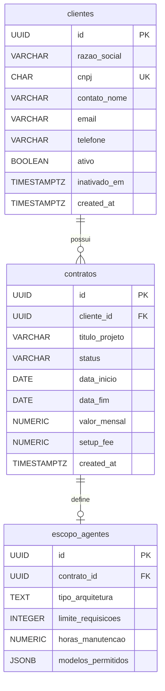

# Banco de dados

> Público: desenvolvedores e operação. Fonte da verdade: os scripts em [`sql/`](../sql).

PostgreSQL gerenciado pelo Supabase, schema `public`, acessado pela API PostgREST.

## Scripts

Execute no **SQL Editor** do Supabase, nesta ordem. Os scripts 01 a 03 podem ser executados de novo sem efeitos colaterais.

| Script | Conteúdo |
|---|---|
| [`01_schema.sql`](../sql/01_schema.sql) | Extensões `pgcrypto` e `pg_trgm`, tabelas, constraints e índices |
| [`02_functions_triggers.sql`](../sql/02_functions_triggers.sql) | RPC `inativar_cliente` e triggers de integridade |
| [`03_rls.sql`](../sql/03_rls.sql) | RLS, políticas, `GRANT`/`REVOKE` e recarga do cache do PostgREST |
| [`04_bootstrap_admin.sql`](../sql/04_bootstrap_admin.sql) | Define o primeiro Admin (editar o e-mail antes) |

## Modelo de dados



### `clientes`

| Coluna | Tipo | Regras |
|---|---|---|
| `id` | `UUID` | PK, `gen_random_uuid()` |
| `razao_social` | `VARCHAR(255)` | obrigatório |
| `cnpj` | `CHAR(14)` | obrigatório, **único**, `^[0-9]{14}$` (sem pontuação) |
| `contato_nome` | `VARCHAR(150)` | obrigatório |
| `email` | `VARCHAR(255)` | obrigatório, `LIKE '%_@_%._%'` |
| `telefone` | `VARCHAR(20)` | opcional |
| `ativo` | `BOOLEAN` | padrão `true` |
| `inativado_em` | `TIMESTAMPTZ` | obrigatório quando `ativo = false` (`clientes_inativacao`) |
| `created_at` | `TIMESTAMPTZ` | padrão `now()` |

Índices: unicidade de `cnpj` (atende a busca exata) e `idx_clientes_razao_social` (GIN trigram, atende `ILIKE '%termo%'`).

### `contratos`

| Coluna | Tipo | Regras |
|---|---|---|
| `id` | `UUID` | PK |
| `cliente_id` | `UUID` | FK → `clientes(id)`; o cliente precisa estar ativo na criação (trigger) |
| `titulo_projeto` | `VARCHAR(255)` | obrigatório |
| `status` | `VARCHAR(30)` | `Ativo`, `Em Implantação`, `Renovação Pendente` ou `Cancelado` |
| `data_inicio` | `DATE` | obrigatório |
| `data_fim` | `DATE` | `data_fim > data_inicio` |
| `valor_mensal` | `NUMERIC(15,2)` | entre 0,01 e 999.999.999,99 |
| `setup_fee` | `NUMERIC(15,2)` | entre 0 e 999.999.999,99; padrão 0 |
| `created_at` | `TIMESTAMPTZ` | padrão `now()` |

Índices: `idx_contratos_cliente_id`, `idx_contratos_status`, `idx_contratos_data_fim`.

### `escopo_agentes`

| Coluna | Tipo | Regras |
|---|---|---|
| `id` | `UUID` | PK |
| `contrato_id` | `UUID` | FK → `contratos(id)`, **único** (1 escopo por contrato), imutável (trigger) |
| `tipo_arquitetura` | `TEXT` | obrigatório |
| `limite_requisicoes` | `INTEGER` | entre 1 e 10.000.000 |
| `horas_manutencao` | `NUMERIC(7,1)` | entre 0,5 e 8.760 |
| `modelos_permitidos` | `JSONB` | array com 1 a 50 itens |

O tipo de cada item de `modelos_permitidos` (texto não vazio com até 100 caracteres) é validado na aplicação (`validate_modelos_permitidos`).

## Funções e triggers

### `inativar_cliente(p_cliente_id uuid) → integer`

Inativa o cliente e cancela os contratos **Ativo** e **Em Implantação** dele numa **única transação**. Retorna quantos contratos foram cancelados. Contratos em **Renovação Pendente** não são alterados.

- Cliente inexistente ou já inativo → erro `P0002` "Cliente não encontrado ou já inativo."
- `SECURITY INVOKER`: roda com as permissões e o RLS de quem chama.
- `EXECUTE` concedido só a `authenticated`.

Uso pela aplicação: `client.rpc("inativar_cliente", {"p_cliente_id": id})` em `repositories/client_repo.deactivate_client()`.

### `trg_contratos_cliente_ativo` (BEFORE INSERT em `contratos`)

Rejeita contrato para cliente inativo com `P0001` "O cliente selecionado está inativo.". A aplicação já valida isso; o trigger garante a regra mesmo fora dela.

### `trg_escopo_contrato_imutavel` (BEFORE UPDATE em `escopo_agentes`)

Rejeita alteração de `contrato_id` com `P0001` "O campo contrato_id não pode ser alterado.".

## Segurança (RLS)

```sql
ALTER TABLE public.clientes ENABLE ROW LEVEL SECURITY;            -- idem contratos, escopo_agentes
GRANT SELECT, INSERT, UPDATE, DELETE ON ... TO authenticated, service_role;
REVOKE ALL ON ... FROM anon;
CREATE POLICY "authenticated_all" ON public.clientes
    FOR ALL TO authenticated USING (true) WITH CHECK (true);
```

| Papel | Acesso |
|---|---|
| `anon` (sem login) | Nenhum: `42501 permission denied` |
| `authenticated` | Leitura e escrita completas nas três tabelas |
| `service_role` | Ignora RLS; usado só para criar usuários |

O `GRANT` explícito existe porque projetos Supabase recentes podem não conceder privilégios automaticamente a tabelas criadas por SQL. O script termina com `NOTIFY pgrst, 'reload schema'` para a API enxergar as tabelas na hora.

> Embora o RLS permita `DELETE` para usuários autenticados, a aplicação nunca exclui registros (verificado em `tests/test_architecture.py`). Se quiser proibir exclusão também no banco, troque a política `FOR ALL` por políticas separadas de `SELECT`, `INSERT` e `UPDATE`.

## Perfis de usuário (Auth)

O perfil fica em `auth.users.raw_app_meta_data ->> 'role'` (exposto à aplicação como `app_metadata.role`). Para consultar:

```sql
SELECT email, raw_app_meta_data ->> 'role' AS perfil, created_at
  FROM auth.users
 ORDER BY created_at;
```

Para promover ou rebaixar alguém:

```sql
UPDATE auth.users
   SET raw_app_meta_data = coalesce(raw_app_meta_data, '{}'::jsonb) || '{"role": "admin"}'::jsonb  -- ou "membro"
 WHERE email = 'pessoa@empresa.com.br';
```

O usuário precisa fazer login de novo para o perfil novo valer na tela. A autorização do cadastro de membros já consulta o valor atualizado na hora.

## Consultas úteis

```sql
-- MRR atual
SELECT sum(valor_mensal) AS mrr FROM contratos WHERE status = 'Ativo';

-- Contratos que vencem nos próximos 30 dias (elegíveis a alerta)
SELECT c.titulo_projeto, cl.razao_social, c.status, c.data_fim, c.data_fim - current_date AS dias
  FROM contratos c JOIN clientes cl ON cl.id = c.cliente_id
 WHERE c.status IN ('Ativo', 'Renovação Pendente')
   AND c.data_fim <= current_date + 30
 ORDER BY c.data_fim;

-- Contratos por status
SELECT status, count(*) FROM contratos GROUP BY status;
```

## Evoluindo o esquema

1. Crie um novo script numerado em `sql/` (ex.: `05_nova_coluna.sql`). Não altere scripts já aplicados em produção.
2. Termine com `NOTIFY pgrst, 'reload schema';`.
3. Atualize o repositório correspondente (`CREATE_FIELDS` / `EDITABLE_FIELDS`), o validador e o serviço.
4. Atualize esta página e o design em `.kiro/specs/crm-agentes-ia/design.md`.
